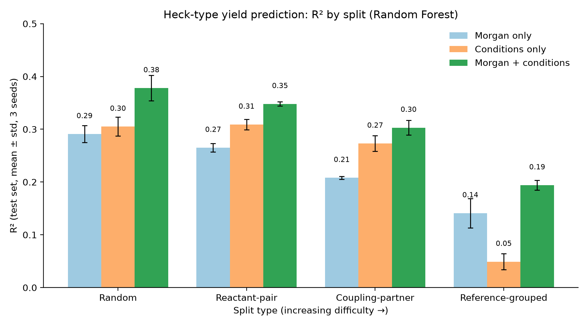

# Chemistry-Aware ML for Heck-Type Reaction Yield Prediction

How much of a yield model's performance survives when the test set contains
unseen reactant pairs, coupling partners, or whole publications?

## Summary
Using 23,495 cleaned literature Heck-type reactions, I compared reactant
structure (Morgan fingerprints), reaction conditions (temperature, time,
reagents, catalysts, solvents), and both combined, under four train/test
splits of increasing difficulty. Structure + conditions was best in every
split, but absolute performance is modest, and the value of conditions
depends heavily on the split.

## Data
- 52,415 Reaxys Heck-type records → 23,495 reactions after cleaning
  (yield parsing, exact-duplicate removal, product-equals-reactant filter,
  complete reaction core, RDKit validation of all structures).
- Broad Heck-type set (oxidative, boron, diazonium, C-H activation,
  photoredox), not only Pd/aryl-halide Heck.
- The data is licensed and **not included** in this repository.

## Features
- **Structure:** Morgan fingerprints (radius 2) of both reactants, 4,096 bits.
  DRFP and RXNFP were also compared.
- **Conditions:** temperature, log time, bag-of-components for
  reagents/catalysts and solvents (vocabulary learned from training rows only),
  and chemistry flags (Pd, phosphine, Rh, Cu, Ag, photoredox, etc.).

## Evaluation design
Random Forest with identical settings (100 trees, max_features = 0.1), 3 seeds,
zero group overlap between train and test:

| Split | Groups held out |
|---|---|
| Random | none |
| Reactant-pair | the (reactant 1, reactant 2) pair |
| Coupling-partner | the non-alkene partner (aryl halide, boron reagent, etc.) |
| Reference-grouped | whole publications |

## Results (R², mean ± std over 3 seeds)
| Split | Morgan | Conditions | Morgan + conditions |
|---|---|---|---|
| Random | 0.291 ± 0.016 | 0.305 ± 0.018 | **0.378 ± 0.024** |
| Reactant-pair | 0.265 ± 0.008 | 0.309 ± 0.010 | **0.348 ± 0.004** |
| Coupling-partner | 0.208 ± 0.003 | 0.273 ± 0.015 | **0.303 ± 0.014** |
| Reference-grouped | 0.141 ± 0.028 | 0.049 ± 0.015 | **0.194 ± 0.009** |

Mean-yield baseline: R² ≈ 0, MAE ≈ 16.4. On unseen publications the best
model reaches MAE ≈ 14.2.



## Key findings
1. Structure + conditions is best in every split.
2. Conditions-only performance stays near 0.3 until publications are held
   out, then collapses to 0.05. A likely explanation is that conditions
   partly identify the source paper (not tested directly).
3. Random-split metrics therefore overstate performance on new experiments.
4. The ranking holds with gradient boosting (HistGradientBoosting) and with
   DRFP, so the pattern is not specific to one model or fingerprint.
5. Block permutation on unseen publications: shuffling either structure or
   conditions drops R² to roughly zero, so both are needed.

## Error analysis
Predictions are compressed toward the mean. On unseen publications the MAE is
≈ 51 for true yields below 20% and ≈ 7 for yields of 60-80%
([parity plot](figures/parity_reference.png)).

## Limitations
- **High-yield skew:** mean yield 70.6%, only ~9.5% of reactions at or below
  40%, none below 1%. Failed experiments are under-reported in the
  literature. The model should not be used to rule out low-yield reactions.
- Three seeds, so standard deviations are rough; no hyperparameter tuning.
- The coupling-partner groups are heuristic for ~21% of reactions.
- The reference split can still be optimistic (one group, several papers).
- About 7,000 reactions with missing temperature or time were excluded.
- Reagent names are used as text features, not converted to structures.
- DRFP, RXNFP and gradient boosting were run on a subset of the splits.

## Related work
HeckLit (J. Org. Chem. 2025) reports R² 0.318-0.380 on a different
10,002-reaction Heck dataset; HTE benchmarks reach R² > 0.9. Datasets and
protocols differ, so these numbers are not directly comparable.

## Repository
```text
heck-yield-ml/
├── results/   per-seed metrics and the final R² table (CSV)
├── figures/   R² by split, parity plot, feature importance
├── src/       feature, split and evaluation code (coming)
├── LICENSE
└── README.md
```
Raw and derived reaction data are excluded via `.gitignore`.

## License
MIT
